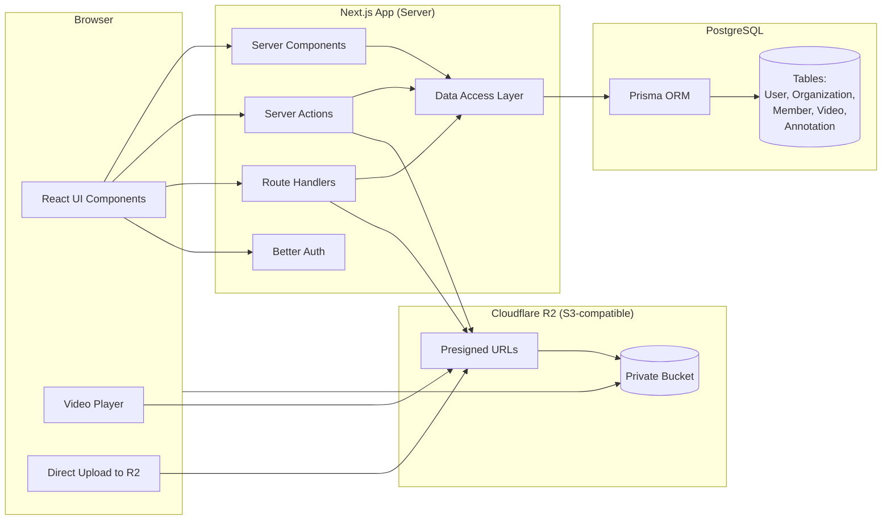
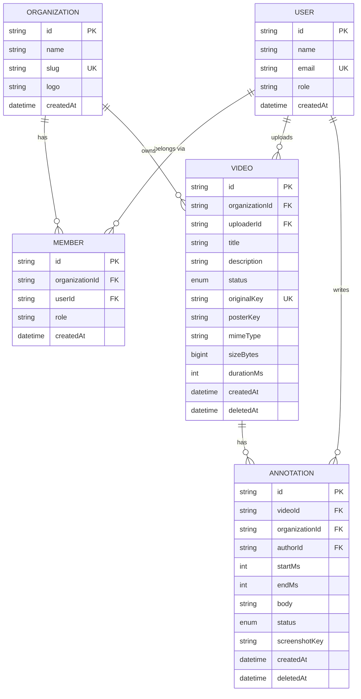

# Anom - Collaborative Video Review Platform

A multi-tenant web application where members of different companies review videos together. Members upload videos, mark time ranges, attach comments, and see all annotations below the player.

## Demo

Watch the platform in action:

[Watch demo video](./workflow.mp4)

## Features

### Authentication
- User registration with email and password
- User login and session management
- Automatic assignment to demo organization on signup
- Protected routes requiring organization membership

### Video
- Upload videos to Cloudflare R2 via presigned URLs.
- Display video catalog with title, uploader, and status.
- Use native HTML5 video player with custom controls.
- Show annotation ranges on video timeline.
- Handle video upload errors and loading states.

### Annotations
- Mark start and end times using player position or manual input
- Comment field
- Save and display annotations without page reload
- Click annotation to seek player to start time
- Delete own annotations


## Tech Stack

- **Framework**: Next.js 16 (TypeScript strict)
- **Database**: PostgreSQL with Prisma ORM
- **Authentication**: Better Auth with organization plugin
- **Storage**: Cloudflare R2 (S3-compatible) via presigned URLs
- **UI**: Tailwind CSS v4 with shadcn/ui components
- **Validation**: Zod schemas shared between client and server

## Architecture

See [ARCHITECTURE.md](ARCHITECTURE.md) for visual diagrams including system overview, data flows, database schema, component hierarchy, API routes, security boundaries, and deployment architecture.

### Multi-tenancy
- All data scoped to organization via Better Auth organizations
- Every query filters by `organizationId`
- Server actions validate session and membership before any operation

### Storage
- Videos never pass through Next.js server
- Browser uploads directly to R2 via presigned PUT URLs
- Server generates presigned URLs for upload (15 min) and playback (1 hour)
- Object keys derived from content type, never from user-supplied filenames

### Data Flow
- Server Components for initial page data
- Server Actions for mutations (create video, create annotation, delete annotation)
- Route Handlers for client-driven reads (pagination, playback URL refresh)
- Client components for interactive features (video player, annotation form)

## System Overview (Level 1)



## Database Schema (ER Diagram)



## Getting Started

### Prerequisites
- Node.js 20+
- PostgreSQL database
- Cloudflare R2 account (or S3-compatible storage)

### Environment Variables

Copy `.env.example` to `.env` and configure:

```bash
cp .env.example .env
```

Required variables:
- `DATABASE_URL` - PostgreSQL connection string
- `BETTER_AUTH_SECRET` - Random secret for auth (generate with `openssl rand -base64 32`)
- `BETTER_AUTH_URL` - Your app URL
- `NEXT_PUBLIC_BETTER_AUTH_URL` - Public app URL
- `R2_ACCOUNT_ID` - Cloudflare R2 account ID
- `R2_ACCESS_KEY_ID` - R2 access key
- `R2_SECRET_ACCESS_KEY` - R2 secret key
- `R2_BUCKET_NAME` - R2 bucket name

Optional OAuth:
- `GITHUB_CLIENT_ID`, `GITHUB_CLIENT_SECRET`
- `GOOGLE_CLIENT_ID`, `GOOGLE_CLIENT_SECRET`

### Installation

```bash
# Install dependencies
bun install

# Generate Prisma client
bun run db:generate

# Run database migrations
bunx --bun prisma migrate dev

# Start development server
bun run dev
```

Open http://localhost:3000

## Usage

### Creating an Account
1. Navigate to `/register`
2. Enter name, email, and password (minimum 10 characters)
3. Account is created and automatically added to the demo organization
4. Redirected to organization catalog

### Uploading a Video
1. Navigate to `/anom-org/upload` or click "Upload Video" from catalog
2. Select a video file (MP4 or WebM, max 5GB)
3. Enter title (required) and description (optional)
4. Click "Upload Video"
5. Progress bar shows upload status
6. After verification, redirected to video page

### Adding Annotations
1. Open a video from the catalog
2. Play video and click "Set start" at desired position
3. Click "Set end" at desired end position
4. Enter a comment
5. Click "Add annotation"
6. Annotation appears in list below player
7. Click annotation in list to jump to that time range

### Managing Annotations
- Your annotations show a dropdown menu with delete option
- Click any annotation to seek player to its start time
- Player automatically pauses at annotation end time

## Project Structure

```
app/
├── (company)/[orgId]/           # Organization-scoped routes
│   ├── page.tsx                 # Organization home (recent videos)
│   ├── catalog/                 # Video catalog
│   │   ├── page.tsx             # Catalog grid
│   │   └── [videoId]/           # Video page
│   │       └── page.tsx         # Video playback + annotations
│   ├── upload/                  # Video upload form
│   └── profile/                 # User profile
├── api/                         # API routes
│   ├── auth/[...all]/           # Better Auth handler
│   ├── videos/                  # Video pagination
│   └── videos/[videoId]/playback-url/  # Playback URL refresh
├── login/                       # Login page
└── register/                    # Registration page

components/
├── video/                       # Video player and annotation components
│   ├── video-workspace.tsx      # Main video page layout
│   ├── video-player.tsx         # Video player with timeline
│   ├── annotation-controls.tsx  # Start/end time + comment form
│   ├── annotation-list.tsx      # Annotation list sidebar
│   └── video.types.ts           # Shared types and utilities
├── ui/                          # shadcn/ui components
├── layout/                      # Header, footer
└── auth/                        # Auth-related components

lib/
├── actions/                     # Server Actions
│   ├── video/                   # Video CRUD operations
│   └── annotation/              # Annotation CRUD operations
├── auth/                        # Better Auth configuration
├── db/                          # Prisma client
├── dal/                         # Data access layer (requireMembership, etc.)
├── storage/                     # R2 storage utilities
│   ├── constants.ts             # MIME types, size limits
│   ├── keys.ts                  # Storage key generation
│   ├── presigned.ts             # Presigned URL generation
│   └── r2.ts                    # R2 client
├── validations/                 # Zod schemas
└── config/                      # Environment validation

prisma/
└── schema.prisma                # Database schema
```

## Security

- All server actions validate session and organization membership
- Data access layer enforces organization scoping
- Presigned URLs are short-lived and never logged
- File uploads verified server-side (size, type, magic bytes)
- User-supplied filenames never used in storage keys
- CSP headers configured for media sources
- Generic error messages to prevent information leakage

## Deployment

### Database
Run migrations in production:
```bash
bunx --bun prisma migrate deploy
```

### Environment
Set all production environment variables. Ensure `NEXT_PUBLIC_APP_URL` and `BETTER_AUTH_URL` match your production domain.

### Storage CORS
Configure R2 bucket CORS to allow your app origin:
```json
[
  {
    "AllowedOrigins": ["https://your-domain.com"],
    "AllowedMethods": ["GET", "HEAD", "PUT"],
    "AllowedHeaders": ["*"],
    "ExposeHeaders": ["ETag"],
    "MaxAgeSeconds": 3600
  }
]
```

## License

Private project.
