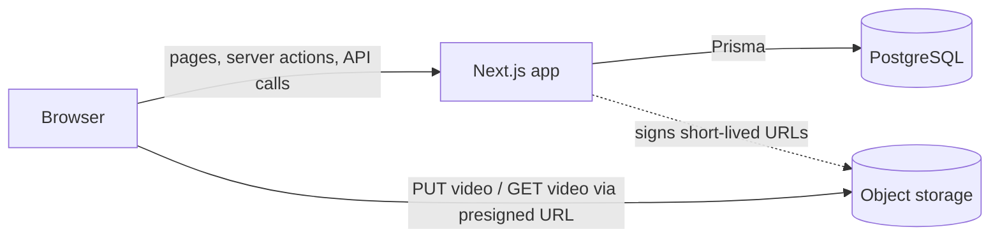
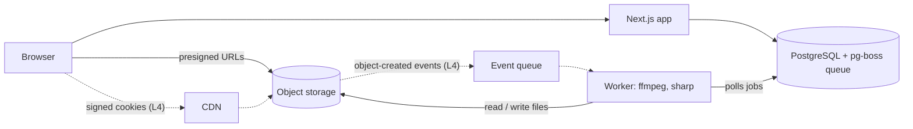
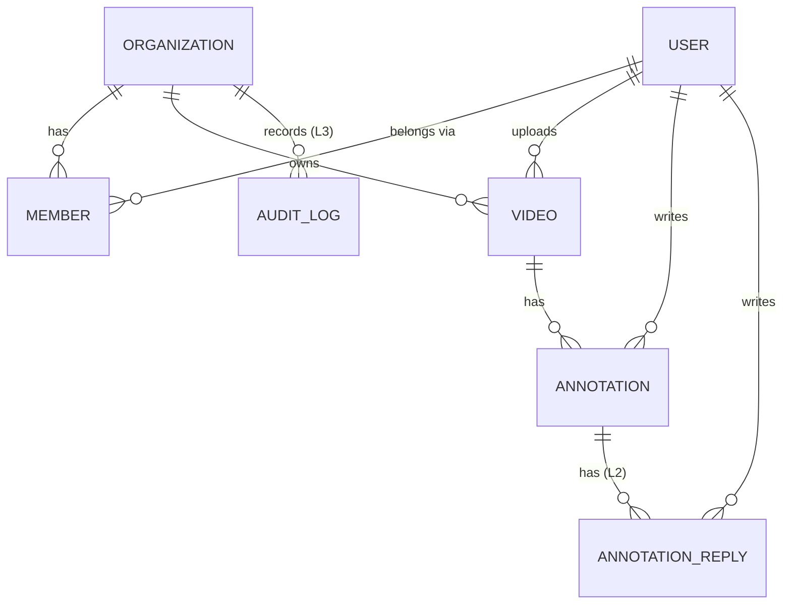
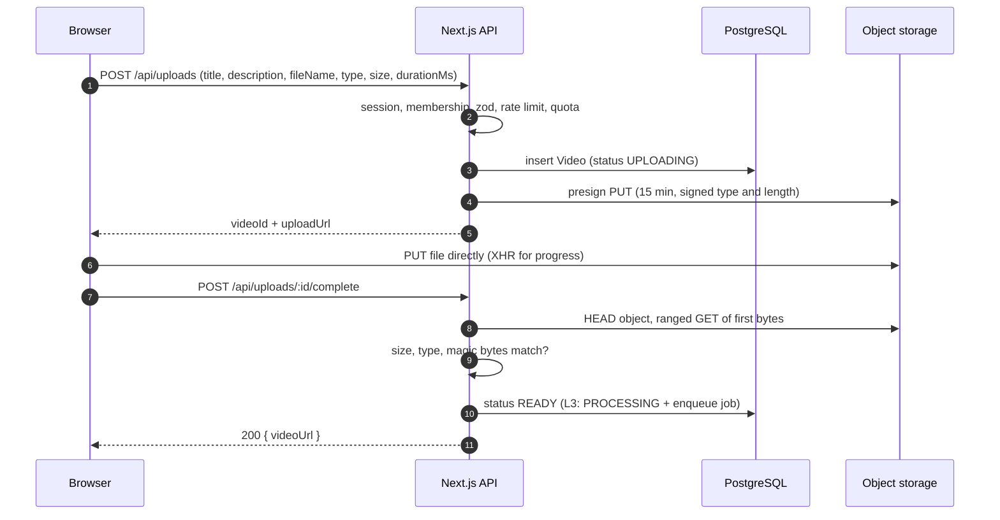
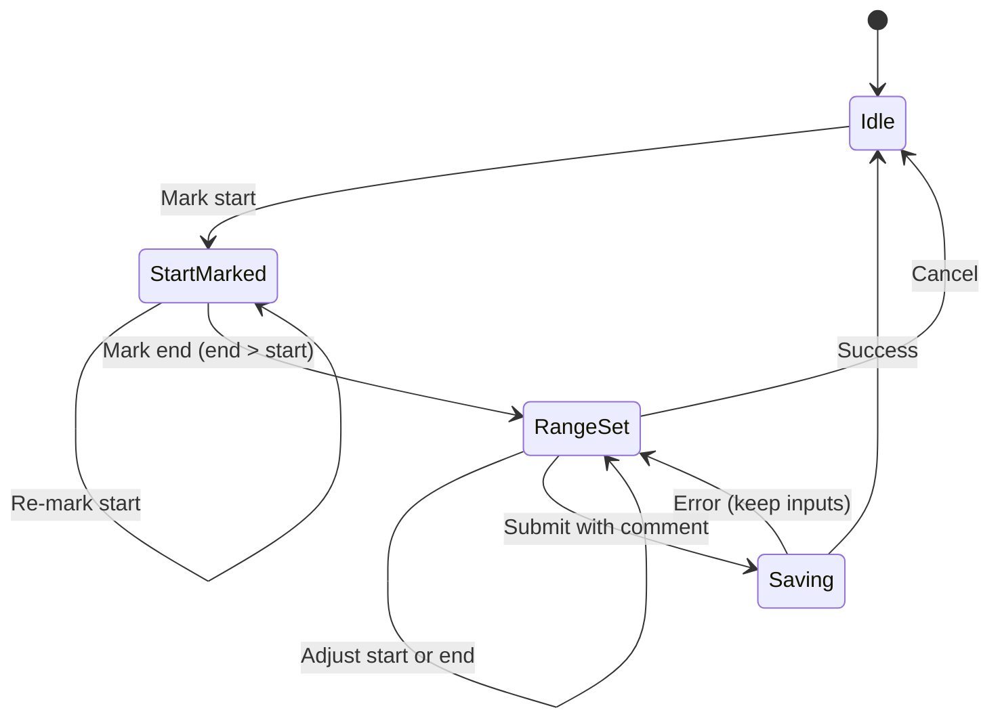

# Architecture: Collaborative Video Review

> **Companion document:** [`project-requirements.md`](./project-requirements.md)
> Requirement IDs (`ANN-3`, `SEC-2`, …) refer to that file.
> Code snippets are **illustrative**: check current library docs for exact option names before copying.

---

## Table of contents

1. [Goals and principles](#1-goals-and-principles)
2. [Technology stack](#2-technology-stack)
3. [System overview by level](#3-system-overview-by-level)
4. [Routing and data-flow conventions](#4-routing-and-data-flow-conventions)
5. [Code organisation](#5-code-organisation)
6. [Data model](#6-data-model)
7. [Authentication and multi-tenancy](#7-authentication-and-multi-tenancy)
8. [Authorization](#8-authorization)
9. [Video storage: decision and layout](#9-video-storage-decision-and-layout)
10. [Upload flow](#10-upload-flow)
11. [Playback flow](#11-playback-flow)
12. [Extracting video information](#12-extracting-video-information)
13. [Annotation feature design](#13-annotation-feature-design)
14. [Pagination and infinite scroll](#14-pagination-and-infinite-scroll)
15. [Level 3: screenshots](#15-level-3-screenshots)
16. [Level 3–4: background uploads, queue and processing](#16-level-34-background-uploads-queue-and-processing)
17. [Security architecture](#17-security-architecture)
18. [Testing, observability, environments](#18-testing-observability-environments)
19. [README outline for the assignment](#19-readme-outline-for-the-assignment)
20. [Decision log](#20-decision-log)

---

## 1. Goals and principles

| Principle | What it means in practice |
|---|---|
| **Small and boring** | Few services, mainstream tools. Level 1 is *Next.js + Postgres + object storage*. Nothing else. |
| **Bytes never touch the app server** | Videos go browser ⇄ object storage using presigned URLs. Serverless body limits, memory and cost problems disappear. |
| **Tenant isolation is structural** | Every table carries a company ID; every query is scoped by it; the check lives in the data layer, not only in the UI. |
| **Server is the authority** | The browser can lie. Validate and authorize on the server every time. |
| **Grow by addition** | Each level adds components; none requires rewriting the previous level. |
| **Business rules are plain functions** | Validation, time maths and permission rules are pure and unit-tested, with no framework in sight. |

---

## 2. Technology stack

| Concern | Choice | Why / alternatives considered |
|---|---|---|
| Framework | **Next.js (App Router), TypeScript strict** | Your choice; server components for initial reads, server actions for mutations, route handlers for the rest. |
| UI | **Tailwind CSS + shadcn/ui** | Accessible primitives, little custom CSS. |
| Validation | **Zod** | One schema shared by the form and the server. |
| Database | **PostgreSQL** | Relational data, strong constraints, can also host the job queue (L3). |
| ORM | **Prisma** | Your choice. Migrations, typed queries. |
| Auth | **Better Auth** (+ `organization` plugin) | Your choice. The organization plugin supplies companies, members, roles (owner/admin/member), invitations and an "active organization" on the session. That is most of Level 4 already. |
| Object storage | **S3-compatible**: Cloudflare R2 in the cloud | See §9. |
| Storage SDK | `@aws-sdk/client-s3` + `@aws-sdk/s3-request-presigner` | Works with R2. |
| IDs | **nanoid** (12 chars) for public IDs | Opaque, URL-friendly, non-sequential. |
| Client data (L2) | **TanStack Query** | Infinite queries, cache, retries. |
| Job queue (L3) | **pg-boss** (Postgres-backed) | See §16. |
| Media tools (L3) | **ffmpeg / ffprobe**, **sharp** | Industry standard. |
| Email (L2) | **Resend** (or any SMTP provider); **Mailpit** locally | |
| Tests | **Vitest**, **Playwright** | Fast unit tests; real-browser E2E. |
| Logging | **pino** (structured JSON) | |
| Errors (L3) | **Sentry** | |
| Packaging | **Docker / Docker Compose** | Reproducible local setup; worker needs a container (ffmpeg). |
| CI | **GitHub Actions** | Lint, type-check, test, `npm audit`, secret scan. |

---

## 3. System overview by level

### Levels 1–2: three components



The Next.js server **signs** URLs but never carries video bytes.

### Levels 3–4: add a worker and (later) a CDN



Solid lines are Level 3. Dotted lines are Level 4 additions.

---

## 4. Routing and data-flow conventions

### Which Next.js mechanism for what

| Need | Use | Why |
|---|---|---|
| **Initial page data** (catalog, video, annotations first page) | **Server Components** calling the data layer | No client round-trip, no API surface to secure twice. |
| **Mutations** (create annotation, delete, edit) | **Server Actions** | Co-located with forms; typed. |
| **Client-driven reads** (infinite scroll, polling processing status) | **Route Handlers** (`GET /api/...`) | Server actions are POST-only and run one at a time per client, which is poor for reads. |
| **Upload API** (create upload, complete upload, refresh playback URL) | **Route Handlers** | Called by a plain TypeScript uploader module outside the React tree. Easier to test. |
| **Auth** | Better Auth handler at `app/api/auth/[...all]/route.ts` | |

---

## 5. Code organisation

Feature folders, with a thin `server/` layer for cross-cutting infrastructure.

```
.
├── prisma/
│   ├── schema.prisma
│   ├── migrations/            # includes raw SQL for CHECK constraints
│   └── seed.ts
├── src/
│   ├── app/                   # routes only: thin, compose features
│   │   ├── (marketing)/page.tsx
│   │   ├── (auth)/login/ · signup/
│   │   ├── [company]/
│   │   │   ├── layout.tsx     # resolves company, convenience redirect only
│   │   │   ├── catalog/page.tsx
│   │   │   ├── catalog/[videoId]/page.tsx
│   │   │   ├── upload/page.tsx
│   │   │   └── profile/page.tsx        # L2
│   │   └── api/
│   │       ├── auth/[...all]/route.ts
│   │       ├── uploads/route.ts                    # POST: create upload
│   │       ├── uploads/[videoId]/complete/route.ts # POST: finalize
│   │       ├── videos/[videoId]/playback-url/route.ts
│   │       └── companies/[company]/videos/route.ts # GET: paginated list
│   ├── features/
│   │   ├── videos/
│   │   │   ├── components/    # VideoCard, VideoGrid, VideoPlayer
│   │   │   ├── queries.ts     # read functions (take a context, scope by company)
│   │   │   ├── actions.ts     # server actions (mutations)
│   │   │   ├── schemas.ts     # zod
│   │   │   └── policies.ts    # who may do what (pure functions)
│   │   ├── annotations/
│   │   │   ├── components/    # AnnotationForm, AnnotationList, TimelineTrack
│   │   │   ├── queries.ts · actions.ts · schemas.ts · policies.ts
│   │   │   └── time.ts        # parse/format/validate ms, pure + unit-tested
│   │   ├── uploads/           # uploader module, UploadProvider (L3)
│   │   └── auth/
│   ├── server/                # server-only; every file starts with `import "server-only"`
│   │   ├── auth.ts            # Better Auth config
│   │   ├── db.ts              # Prisma client singleton
│   │   ├── context.ts         # requireSession(), requireMembership()
│   │   ├── storage/           # s3 client, keys.ts, presign.ts, verify.ts
│   │   ├── rate-limit.ts
│   │   ├── env.ts             # zod-validated environment
│   │   └── logger.ts
│   └── lib/                   # shared, isomorphic helpers (ids, cursors, formatters)
├── worker/                    # L3: separate Node process + Dockerfile (ffmpeg)
│   ├── index.ts · jobs/process-video.ts · jobs/cleanup.ts
├── docker-compose.yml         # postgres, minio (+ bucket init), mailpit
├── tests/ (e2e, integration)
└── README.md
```

---

## 6. Data model



`USER`, `SESSION`, `ACCOUNT`, `VERIFICATION`, `ORGANIZATION`, `MEMBER` and `INVITATION` tables are **generated by Better Auth's CLI**. *Company = Organization.* The tables below are ours.

```prisma
enum VideoStatus      { UPLOADING PROCESSING READY FAILED }
enum AnnotationStatus { OPEN RESOLVED }                       // RESOLVED used from L3

model Video {
  id             String      @id                     // nanoid(12)
  organizationId String
  uploaderId     String
  title          String      @db.VarChar(120)
  description    String?     @db.VarChar(1000)
  status         VideoStatus @default(UPLOADING)

  originalKey    String      @unique                 // videos/{org}/{id}/original.mp4
  playbackKey    String?                             // L3: transcoded rendition
  posterKey      String?                             // L2: thumbnail
  mimeType       String
  sizeBytes      BigInt
  durationMs     Int?                                // client-reported in L1, ffprobe in L3
  width          Int?
  height         Int?
  fps            Float?

  createdAt      DateTime    @default(now())
  updatedAt      DateTime    @updatedAt
  deletedAt      DateTime?                           // soft delete

  organization   Organization @relation(fields: [organizationId], references: [id])
  uploader       User         @relation(fields: [uploaderId], references: [id])
  annotations    Annotation[]

  @@unique([id, organizationId])                     // enables composite FK below
  @@index([organizationId, createdAt(sort: Desc), id(sort: Desc)])   // catalog
  @@index([uploaderId, createdAt(sort: Desc)])                       // profile
}

model Annotation {
  id             String           @id                // nanoid(12)
  videoId        String
  organizationId String                              // denormalised on purpose
  authorId       String
  startMs        Int
  endMs          Int
  body           String           @db.VarChar(2000)
  status         AnnotationStatus @default(OPEN)
  screenshotKey  String?                             // L3
  createdAt      DateTime         @default(now())
  updatedAt      DateTime         @updatedAt
  deletedAt      DateTime?

  video   Video @relation(fields: [videoId, organizationId], references: [id, organizationId])
  author  User  @relation(fields: [authorId], references: [id])
  replies AnnotationReply[]

  @@index([videoId, startMs, id])                    // list below player
  @@index([authorId, createdAt(sort: Desc)])         // profile
}

model AnnotationReply {                              // L2
  id           String   @id
  annotationId String
  authorId     String
  body         String   @db.VarChar(2000)
  createdAt    DateTime @default(now())
  deletedAt    DateTime?
  @@index([annotationId, createdAt])
}
```

---

## 7. Video storage: decision and layout

### Decision

**Use S3-compatible object storage, with browser-direct uploads through presigned URLs.** Production target: **Cloudflare R2**. Hide it behind a small `StorageService` interface so the provider can change without touching features.

### Presigned URL capabilities that matter

Because **R2 does not support presigned POST** and S3 does, design for the common denominator: **presigned `PUT`** with signed `Content-Type` and `Content-Length`, **plus server-side verification after upload** (§10). Do not rely on a POST policy's `content-length-range`. That keeps the code portable and the safety net explicit.

> A presigned URL is a **bearer token**: anyone holding it can use it until it expires. Keep lifetimes short, never log them, and never put them in analytics.

### Bucket layout and naming

```
videos/{orgId}/{videoId}/original.{ext}        # as uploaded
videos/{orgId}/{videoId}/playback.mp4          # L3 transcoded rendition
videos/{orgId}/{videoId}/poster.jpg            # thumbnail (L2 client, L3 worker)
screenshots/{orgId}/{videoId}/{annotationId}.jpg   # L3
tmp/{orgId}/{uuid}.jpg                         # L3 staging; lifecycle-expired after 1 day
```

- Including `orgId` in the key enables prefix-scoped IAM or lifecycle rules later, and makes deleting a company a prefix delete.

### Bucket configuration checklist

| Setting | Value |
|---|---|
| **Block all public access** | ON |
| **Default encryption** | ON (SSE-S3, or SSE-KMS for stricter needs) |
| **CORS** | Only the app origin(s); methods `GET, HEAD, PUT`; expose `ETag` |
| **Lifecycle** | Abort incomplete multipart uploads after 1 day; expire `tmp/` after 1 day; optionally transition originals to cheaper storage after N days |
| **Versioning** | Optional (protects against accidental deletes; costs storage) |
| **Access logging** | ON in production |
| **Separate origin** | Serve media from the storage/CDN domain, **not** from the app's domain (cookies are never sent there, and uploaded content cannot run in the app's origin) |

### Least-privilege IAM for the app

Presigned URLs carry the **signer's** permissions, so the signing identity must be minimal.

```json
{
  "Version": "2012-10-17",
  "Statement": [
    {
      "Effect": "Allow",
      "Action": ["s3:PutObject", "s3:GetObject", "s3:DeleteObject",
                 "s3:AbortMultipartUpload", "s3:ListMultipartUploadParts"],
      "Resource": "arn:aws:s3:::YOUR-BUCKET/*"
    },
    {
      "Effect": "Allow",
      "Action": ["s3:ListBucket"],
      "Resource": "arn:aws:s3:::YOUR-BUCKET"
    }
  ]
}
```

No `s3:*`, no other buckets, no account-wide permissions. Use a role (not long-lived keys) where the platform allows.

---

## 8. Upload flow

### Levels 1–2: single presigned PUT



### Server-side checks at "create upload" (before issuing a URL)

| Check | Detail |
|---|---|
| Authenticated member of the company | `requireMembership` |
| Schema | Title/description length; content type in allowlist (`video/mp4`, `video/webm`); `sizeBytes` ≤ max; `durationMs` within sane bounds (> 0, ≤ 4 hours, for example) |
| Quota | Uploads/day and total storage per user |
| Rate limit | e.g. 10 create-upload calls / hour / user |
| Key generation | `videos/{org}/{id}/original.{ext}`; extension from content type, not filename |

### Server-side checks at "complete"

| Check | Detail |
|---|---|
| Ownership | The caller is the uploader; the video belongs to their company and is still `UPLOADING` |
| Object exists | `HeadObject` succeeds |
| Size | `ContentLength` equals the declared size (and ≤ max) |
| Content type | Matches what was declared |
| **Magic bytes** | Ranged `GetObject` for the first ~32 bytes: MP4 has an `ftyp` box at offset 4; WebM/Matroska starts with `1A 45 DF A3`. Mismatch ⇒ delete the object, mark `FAILED`. |
| Idempotency | Calling `complete` twice is harmless |

### Failure handling

| Failure | Handling |
|---|---|
| User closes the tab mid-upload | Row stays `UPLOADING`. A scheduled sweep (L2/L3) deletes `UPLOADING` rows older than 24 h and their objects. A lifecycle rule aborts incomplete multipart uploads. |
| Upload succeeds but `complete` never called | Same sweep (optionally reconciles by checking the object exists, then completes it). |
| Network error during upload | UI shows retry; retry reuses the same presigned URL until expiry, then requests a new one. |
| File fails verification | Object deleted, status `FAILED`, user sees a clear message. |

---

## 09. Playback flow

1. The video page loads the video through the **scoped query**.
2. The server generates a **presigned GET** (default **1 hour**) for `playbackKey ?? originalKey`, with `ResponseContentType` set and `ResponseContentDisposition: inline`.
3. The `<video>` element uses that URL. S3 serves **HTTP Range** requests, so seeking works without any proxy.
4. **Expiry handling (VID-4):** on the player's `error` event, the client calls `GET /api/videos/:id/playback-url`, swaps the `src`, restores `currentTime`, and resumes if it was playing.

**Encoding notes for good seeking:** MP4 with the `moov` atom at the start (`-movflags +faststart`) and regular keyframes (every 1–2 s) make scrubbing and frame-accurate review feel instant. Level 1 accepts whatever the user uploads. Level 3 normalises it.

---

## 10. Annotation feature design

### Interaction states



Keep this as a small reducer (`useReducer`) so it is unit-testable without rendering. Typing in the time fields uses the same parse/validate functions as the buttons.

### Data flow

- **Create:** server action → validate, scope, insert → `revalidatePath`. For instant feedback, apply `useOptimistic` so the item appears immediately and reconciles with the server's ID.
- **The timeline needs *all* ranges; the list is paginated (L2).** These are two different reads:
  - `GET …/annotations/ranges` returns a lightweight array `{id, startMs, endMs, status, authorId}` for the whole video (hard cap 1000). Used by the timeline.
  - `GET …/annotations?cursor=…` returns full items page by page. Used by the list.
  
  In L1 both can come from one query; split them when infinite scroll arrives so the timeline stays complete.

---

## 11. Pagination and infinite scroll

Use **keyset (cursor) pagination**, not `OFFSET`: it stays fast on large tables and doesn't skip or duplicate rows when new data arrives mid-scroll.

---

## 12. Level 3–4: background uploads, queue and processing

Two different things are both called "background" here:

1. **Client-side background upload:** the user can keep using the app while a file uploads.

### 12.1 Client-side background uploads (L3)

**Goal:** navigate freely while a large upload continues.

- Mount a client `<UploadProvider>` in the **root layout**. In the App Router, client-side navigation keeps the root layout mounted, so state and in-flight requests inside it survive page changes.
- The provider owns an `UploadManager`: a queue of uploads with states `queued → uploading → verifying → done | failed | cancelled`. Pages talk to it through a hook. A small global indicator (corner widget) shows progress and offers cancel/retry.
- A **full page reload or tab close still kills an in-flight upload.** Mitigations:
  - `beforeunload` warning while uploads are active.
  - Multipart + persisted state (§10) so the user can resume after returning.
- Service-worker "Background Sync" is **not** a reliable way to upload large files across browsers. Don't build on it.

---

## 13. Decision log

| ID | Decision | Alternatives considered | Reason |
|---|---|---|---|
| ADR-01 | **Tenancy via Better Auth organizations**; membership table from day one | `companyId` column on user; custom Company model | Many-to-many ready; roles and invitations already built; minimal Level 4 effort |
| ADR-02 | **S3-compatible storage + browser-direct presigned PUT** | Proxy through Next.js; Cloudflare R2; Mux | Security control, portability, no body-limit issues. Managed services kept as an L3/L4 escape hatch |
| ADR-03 | **Private bucket + short-lived presigned GET** (L4: CDN signed cookies) | Public bucket; long-lived URLs | Leaked links expire; no public exposure |
| ADR-04 | **Post-upload verification** (HEAD + magic bytes) instead of relying on POST policy | Presigned POST with content-length-range | Works on both S3 and R2; explicit safety net |
| ADR-05 | **Native `<video controls>` + custom annotation track below** | Fully custom player; Video.js/Vidstack | Free accessibility and fullscreen; minimal code; the timeline is our unique value |
| ADR-06 | **Timestamps as integer ms**, one shared validation function | Float seconds | No drift; exact comparisons; simple DB constraints |
| ADR-07 | **Keyset pagination** from Level 1 | Offset pagination | Stable under inserts; fast; Level 2 is UI-only |
| ADR-08 | **Authorization in the data layer** (`ctx` required), not middleware or layouts | Middleware-based auth | Middleware and layouts can be bypassed or skipped; data-layer checks cannot |
| ADR-09 | **Screenshots captured in the browser**, re-encoded server-side | Server-side ffmpeg frame extraction | WYSIWYG, supports markup, instant; requires CORS and server re-encode |
| ADR-10 | **pg-boss** for jobs at Level 3 | BullMQ + Redis; SQS; managed workflows | No new infrastructure; transactional with DB; enough for this scale |
| ADR-11 | **Transcode to H.264/AAC MP4 with faststart** at L3; HLS/managed at L4 | Serve originals | Compatibility and fast seeking, which are essential for frame-accurate review |
| ADR-12 | **404 for foreign resources** | 403 | Doesn't reveal that a resource or company exists |
| ADR-13 | **Client-reported duration in L1**, ffprobe-verified in L3 | Server-side parsing in L1 | Keeps L1 simple; low risk; clearly documented |
